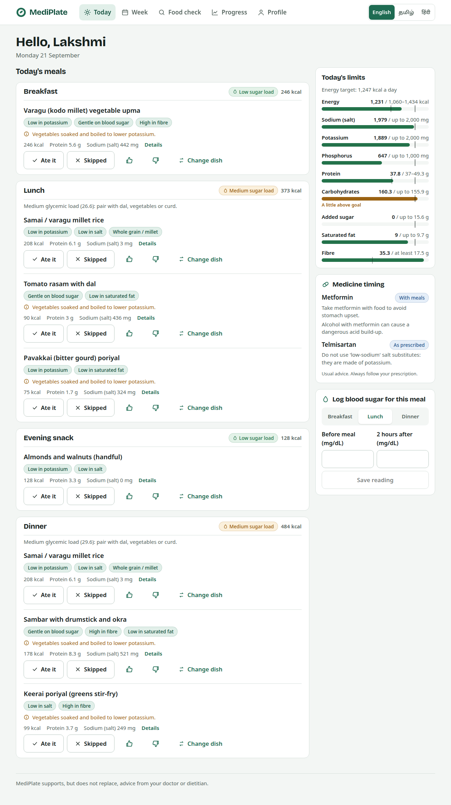

# MediPlate

A full-stack website that builds safe weekly meal plans for adults aged 30+
living with one or more of: diabetes, high blood pressure, heart disease or
stroke, obesity, chronic kidney disease, fatty liver, metabolic syndrome and
arthritis (osteoarthritis, rheumatoid, gout).

It reads each patient's conditions, medicines and lab results, removes every
dish that clashes with them, resolves conflicting diet advice by clinical
priority, and fills the week from the patient's **own region's food first**
(North, South, East, West, North-East). Every choice is explained. English,
Tamil and Hindi.

> MediPlate is a university prototype. The clinical rules and recipes must be
> reviewed by a registered dietitian and a pharmacist before any patient use.



---

## Run it

**Windows:** double-click `scripts\start.bat`
**Linux / macOS:** `./scripts/start.sh`
**Docker:** `docker compose up --build`

Then open **http://localhost:8000**. You need Python 3.11+ and Node 20+ (not
needed for Docker).

Admin console: sign in as `admin@mediplate.in` / `ChangeMe!2026`, then change
these with the `MEDIPLATE_ADMIN_EMAIL`, `MEDIPLATE_ADMIN_PASSWORD` and
`MEDIPLATE_SECRET_KEY` environment variables before sharing the site.

Development with hot reload: `./scripts/dev.sh` (website on :5173, API on :8000).
Run every check: `./scripts/test_all.sh`.

---

## How the pieces connect

The IDs match the project blueprint.

```
pipeline/  ── fetch ─ clean ─ merge ─ validate ─ train ──►  backend/app/data/*.json, backend/app/models/*
                                                                      │ loaded at start-up (knowledge.py)
frontend/ (F1, React)  ◄── /api (JSON) ──►  backend/ (B1, FastAPI)
                                              │
      every plan request runs the engine:     ▼
      E1 profile builder → E3 targets + conflict ledger → E2 safety filter → E4 optimizer → E5 explainer
                               ▲                              ▲                  ▲
                          M1 risk scorer                 D3 rules KB        M2 glucose, M3 ranker
                                                                                  ▲
      meal logs, ratings and after-meal sugar readings ───────────────────────────┘ (learning loop)
```

| Part | Where | What it does |
|---|---|---|
| Data pipeline | `pipeline/run_all.py` | Downloads IFCT 2017 and SAheart (cached copies used offline), converts units, fixes data-quality errors, costs 186 recipes, compiles and **schema-checks** every rule, trains M1. Stops with a clear error instead of writing broken files. |
| E1 Profile builder | `engine/profile.py` | BMI (Indian cut-offs), eGFR (CKD-EPI 2021), kidney stage, reference body weight. Turns on kidney-safe limits automatically if eGFR < 60. |
| E3 Targets | `engine/targets.py` | Collects limits from each condition, medicine, risk result and healthy-eating default; merges them; resolves clashes by priority and writes each one to a plain-language ledger. |
| E2 Safety filter | `engine/safety.py` | Removes dishes that break diet type, allergies, beef/pork choice, condition rules, medicine rules, or a hard limit even at the smallest salt-reduced portion. |
| E4 Optimizer | `engine/optimizer.py` | Mixed-integer programme (OR-Tools CBC). Picks dish × portion × salt level × potassium soaking for 9 slots a day. Hard limits are constraints; goals are penalties. Tries home region first, then neighbouring zones, then all-India dishes. |
| E5 Explainer | `engine/explainer.py` | Why each dish fits, region of origin, day totals checked against every limit, meal sugar load, removed dishes, medicine timing. |
| Food check | `engine/foodcheck.py` | One merged, prioritised verdict (fits / limit / avoid) for any dish or IFCT food, searchable in English, Tamil or Hindi. |
| M1 Health-risk scorer | `engine/risk.py` | Trained heart-risk model (AUC 0.77) plus validated calculators: FIB-4, Indian Diabetes Risk Score, IDF metabolic-syndrome criteria, HbA1c, BP, potassium. High heart risk tightens the plan. |
| M2 Glucose response | `engine/glycemic.py` | Glycemic load per serving and per meal; after 3 before/after-meal readings it fits the patient's own sugar response and uses it in planning. |
| M3 Meal ranker | `engine/ranker.py` | Learns from eaten / skipped / liked / disliked meals, spread across ingredients, so a disliked vegetable drops from other dishes too. |

## Data

| Source | Status | Used for |
|---|---|---|
| IFCT 2017, NIN-ICMR, 542 foods (via the `ifct2017` npm package) | ✅ downloaded, cached in `pipeline/raw/` | All nutrient values |
| USDA SR Legacy, 11 foods missing from IFCT (curd, salt, oats…) | ✅ `pipeline/sources/supplements.csv` | Gap-filling |
| South African Heart Disease (462 adults) via PMLB | ✅ downloaded | M1 training |
| MediPlate regional recipes (186 dishes, 5 zones) | ✅ hand-built, `pipeline/sources/recipes.yaml` | Dish table; **needs dietitian review** |
| Disease rules, 65 medicines' food rules, food tags | ✅ hand-built from ICMR-NIN 2024, ADA 2025, KDIGO 2024, AHA/DASH, EASL 2024, ACR 2020, drug labels | Safety filter and limits; **needs clinical review** |
| Glycemic index table | ✅ approximate values from the International GI Tables | Sugar load |
| Messages in English, Tamil, Hindi (195) | ✅ `pipeline/sources/rules/messages.yaml` | All explanations; **needs native-speaker review** |
| NHANES, USDA FoodData Central API, UCI CKD, Kaggle Indian Food 101 | ⛔ blocked from the build machine | Add later |
| CGMacros (PhysioNet) | ⛔ needs a data-use agreement | Put CSVs in `pipeline/raw/cgmacros/` and re-run the pipeline: step 5 trains M2 automatically |

Data-quality fixes are logged to `pipeline/reports/data_quality.md` (one IFCT
entry, chicken leg, listed 384 kcal but its macronutrients give 192).

Note: the `ifct2017` npm package is AGPL-3.0 licensed; only its data files are
used. Check your institution's licensing guidance before publishing.

## Tests

* **91 backend tests** (`backend/tests`), including a property test that makes
  plans for 36 random patients (all states, diets, condition combinations,
  kidney stages, labs and 14 medicine groups). It then recomputes each day from
  the raw dish data and checks every hard limit, the vitamin K band, per-meal
  carbohydrate floors, the safety filter and the region rule. All 72 planned
  days stayed in the home region.
* **Website type-check**: `npm run build` fails on any type error or missing translation.
* **5 browser tests** (`e2e/`): sign up → 5-step onboarding → plan → log a meal →
  swap a dish → food check in Tamil script → add a result → switch languages →
  mobile layout (no sideways scroll) → sign out and in → admin console. The
  journey test fails on any browser console error.

## Configuration

| Variable | Default |
|---|---|
| `MEDIPLATE_DATABASE_URL` | SQLite file `backend/mediplate.db` (PostgreSQL: `postgresql+psycopg://…`, install `requirements-postgres.txt`) |
| `MEDIPLATE_SECRET_KEY` | change in production |
| `MEDIPLATE_ADMIN_EMAIL` / `_PASSWORD` | `admin@mediplate.in` / `ChangeMe!2026` |
| `MEDIPLATE_SOLVER_SECONDS_PER_DAY` | `2.5` |

## Known limits of version 1

* Recipes, rules and translations are careful prototypes, not clinically validated.
* M1 is trained on South African adults; it is shown as a research indicator only.
* M2 uses glycemic load until each patient logs their own readings (or CGMacros is added).
* Not included, as agreed in the blueprint: food prices, doctor/dietitian portal (U2),
  food photo recognition (M4), live glucose-sensor sync.
* Docker and PostgreSQL configurations are provided but were not run on the build
  machine; the SQLite path is the one covered by the tests.
